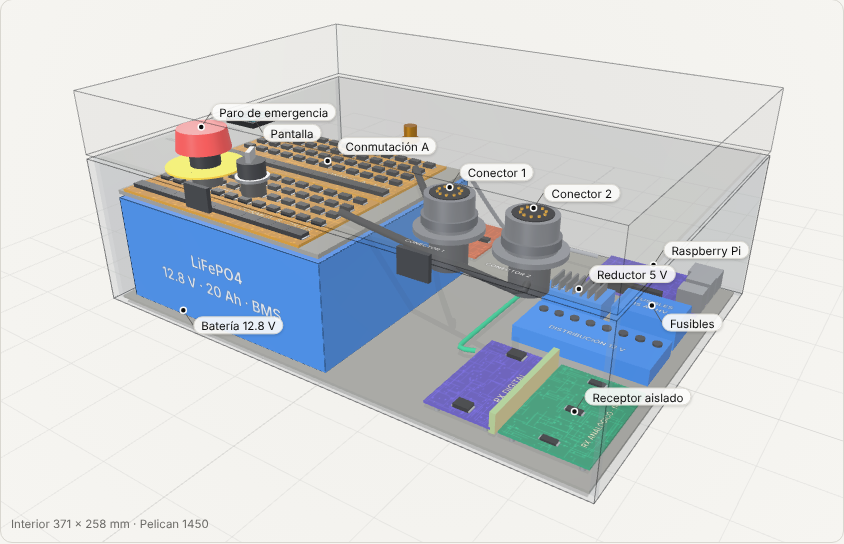

# VENUS: resistivímetro multielectrodo de bajo costo para tomografía de resistividad eléctrica (TRE)

**VENUS** es la propuesta de diseño, modelado analítico y análisis de costos de un resistivímetro de un canal y 48 electrodos para tendidos simples de unos 200 m. **No se construyó hardware**: todas las cifras de desempeño son estimaciones analíticas pendientes de validación en banco y en campo.

**Autor:** Ian A. Sandoval-Valderrábano, Facultad de Ingeniería, Benemérita Universidad Autónoma de Puebla (BUAP).



## Contenido
- [`paper/VENUS_Resistivimetro_TRE_IEEE.pdf`](paper/VENUS_Resistivimetro_TRE_IEEE.pdf): documento en estilo IEEE (6 páginas; no es la plantilla oficial).
- [`interactivo/index.html`](interactivo/index.html): una sola página (ábrela en el navegador, sin internet) con resumen, modelo 3D del interior, calculadora de costos y el paper.
- [`datos/lista_materiales.csv`](datos/lista_materiales.csv): lista de materiales de 29 líneas con rangos bajo, base y alto, la fuente de cada precio y si es precio visto (V) o estimación (E).
- [`codigo/presupuesto_senal.py`](codigo/presupuesto_senal.py): reproduce la señal esperada, el número de lecturas, el tiempo y la energía del paper.

## El diseño de VENUS en breve
- **Transmisor:** riel de 200 V limitado a 80 mA, con inversión de polaridad cada 0.5 s.
- **Receptor:** flotante, ADS1262 de 32 bits, aislado con ISO7741 y convertidores aislados.
- **Conmutación:** 192 canales (48 electrodos × roles A, B, M, N) con 96 PhotoMOS AQW214, controlados por un Raspberry Pi 4B.
- **Energía y carcasa:** batería LiFePO4 de 12.8 V y 20 Ah (256 Wh) en una maleta Pelican 1450 (IP67).
- **Arreglos:** Wenner, Wenner-Schlumberger y dipolo-dipolo, con secuencias exportables a ResIPy y pyGIMLi.

## Resultados (estimaciones)
| Concepto | Valor |
|---|---|
| Señal más débil del plan (dipolo-dipolo, a = 16 m, n = 6, 20 Ωm, 50 mA) | 59 µV |
| Wenner completo (360 lecturas, un canal) | unos 13 min |
| Autonomía con 256 Wh (peor caso, 18.5 W) | unas 14 h |
| Instrumento sin tendido | unos 1 114 USD (800–1 778) |
| Sistema completo con cable y electrodos | unos 2 866 USD (1 584–4 234) |

Solo 12 de las 29 líneas de la lista tienen precio visto en un distribuidor (65 % del costo base); las otras 17 son estimaciones del autor.

## Límites que conviene leer
- **Riesgo principal:** la fuga de los PhotoMOS en estado abierto (hasta 1 µA según la ficha) puede dar hasta 2 mV con una resistencia de contacto de 2 kΩ, más que la señal del caso más débil. No se midió; el paper propone pruebas y una variante con relés reed.
- **El desarrollo domina el costo:** solo la ingeniería (550–1 010 horas a 25–80 USD/h, supuesto del autor) costaría entre 13 750 y 80 800 USD. Un equipo propio solo se justifica si se fabrican varias unidades, si se necesita una función que no existe comercialmente o si el tiempo cuenta como aprendizaje.
- **Precios:** vistos en listados de distribuidores en noviembre de 2026 y sujetos a cambio. Quedan fuera impuestos, envío, repuestos y la tableta del operador.
- **Seguridad:** un riel de 200 V CC está por encima del umbral de 60 V CC de la norma IEC 61010-1. Las medidas del paper (paro de emergencia, llave, fusibles, sangrador) deben revisarse con un laboratorio y con personal calificado antes de construir nada.

## Uso
```
python codigo/presupuesto_senal.py     # imprime la tabla de señales, lecturas, tiempos y energía
```
Para ver el modelo 3D y la calculadora, abre `interactivo/index.html` en un navegador moderno.

## Licencia
El código, la página interactiva y la lista de materiales están bajo licencia MIT (ver [`LICENSE`](LICENSE)). El texto y las figuras del paper son del autor. La página interactiva incluye [three.js](https://threejs.org) (licencia MIT, © los autores de three.js). Las marcas y números de parte pertenecen a sus fabricantes.
